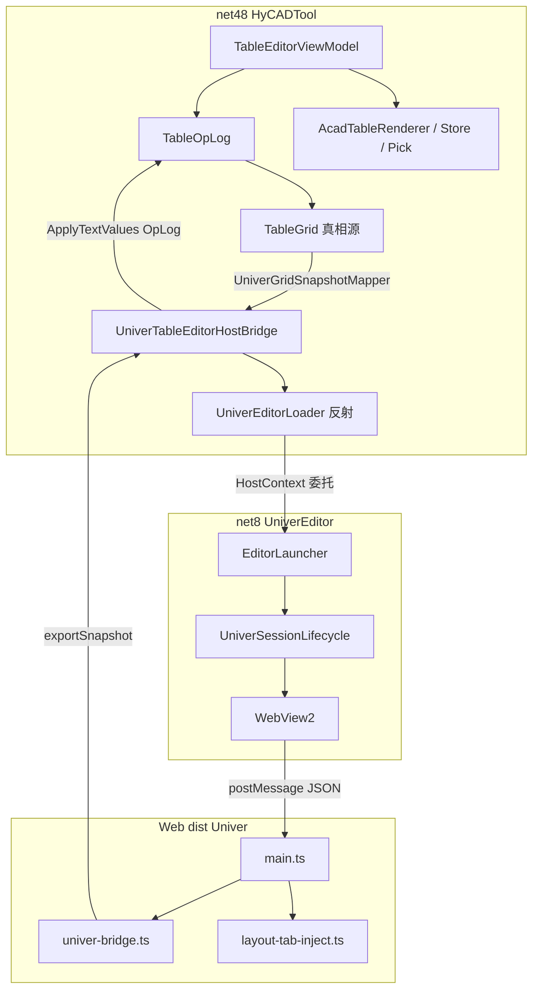

# 项目架构

## 项目目标

在 AutoCAD 插件内提供独立表格编辑器：Excel 级网格 + Office 级功能区 + CAD 落图，替代难用的原生 TABLE。服务工程制图员与模板维护者。

**当前主线（2026-06-26 决策）**：**方案 C — Univer OSS + WebView2**（ReoGrid / Fluent.Ribbon 方案 B 降为备选，代码保留）。

## 技术栈

| 层级 | 技术 | 说明 |
|---|---|---|
| Domain | `HyCAD.Tables`（netstandard / 主工程引用） | `TableGrid` + `TableOpLog` 唯一真相源 |
| 宿主 | net48 `HyCADTool` | 命令、PaletteSet、CAD 渲染/拾取/XData |
| 编辑器侧车 | net8.0-windows `HyCADTool.UniverEditor` | WebView2 承载 Univer；反射加载 |
| 前端 | Univer OSS + Vite（`Web/`） | 网格 UI；`postMessage` JSON 快照 |
| CAD | AcadTableRenderer / Store / Pick | 落图、竖排、斜线、PhotoSlot、round-trip |

## 模块划分

## 数据流 / 交互

| 通道 | 机制 | 内容 |
|---|---|---|
| 反射桥 | `UniverEditorLoader` → `UniverEditorHostContext` | 新建/拾取/落图/xlsx/状态摘要 |
| JSON 快照 | WebView2 `postMessage` ↔ `univer-bridge.ts` | `loadSnapshot` / `exportSnapshot` / `cellChanged` / 布局消息 |

**口径 B（纸面 mm）**：Domain / 布局 Tab / 拾取读回均用纸面 mm；仅落图时几何与字高等 **×Scale** 进模型空间；Scale 打开时取 hy 面板，关编辑器不持久化。

## 关键架构决策

| 决策 | 选择 | 理由 | 日期 |
|---|---|---|---|
| 真相源 | `TableGrid` + `TableOpLog` | Univer workbook 仅视图壳 | 2026-06 |
| 持久化 | XData / 扩展字典 JSON（AC3） | 不用 Univer 原生文件当真相源 | 2026-06 |
| 编辑器内核 | Univer OSS + WebView2 | Excel 观感与 Ribbon 上限更高 | 2026-06-26 |
| Excel 互通 | C# NPOI（`TableGridXlsxAdapter`） | 不经 Univer Pro xlsx | 2026-06 |
| 320px PaletteSet Tab | 保留 `TableFillGridView` | 不在 Univer 替换范围 | 2026-06 |
| 尺寸口径 | 口径 B：纸面 mm + 落图 ×Scale | 与 CAD 模型空间一致 | 2026-06-27 |

## 目录映射

| 路径 | 职责 |
|---|---|
| `src/HyCAD.Tables/` | Domain 拓扑/合并/角色/样式/纸张 |
| `src/HyCADTool/Features/Tables/` | VM、桥、CAD Infrastructure、命令 |
| `src/HyCADTool.UniverEditor/` | net8 窗口、WebView2、Web 前端 |
| `src/HyCADTool.UniverEditor/Web/` | Univer 插件栈、布局 Tab、dev 5174 |

详细总纲：[Plan/001-Univer路线-原需求最优落地总纲](Plan/001-Univer路线-原需求最优落地总纲-2026-06-26-163000.md)

---

**版本**：v1.0 | **更新**：2026-07-15
