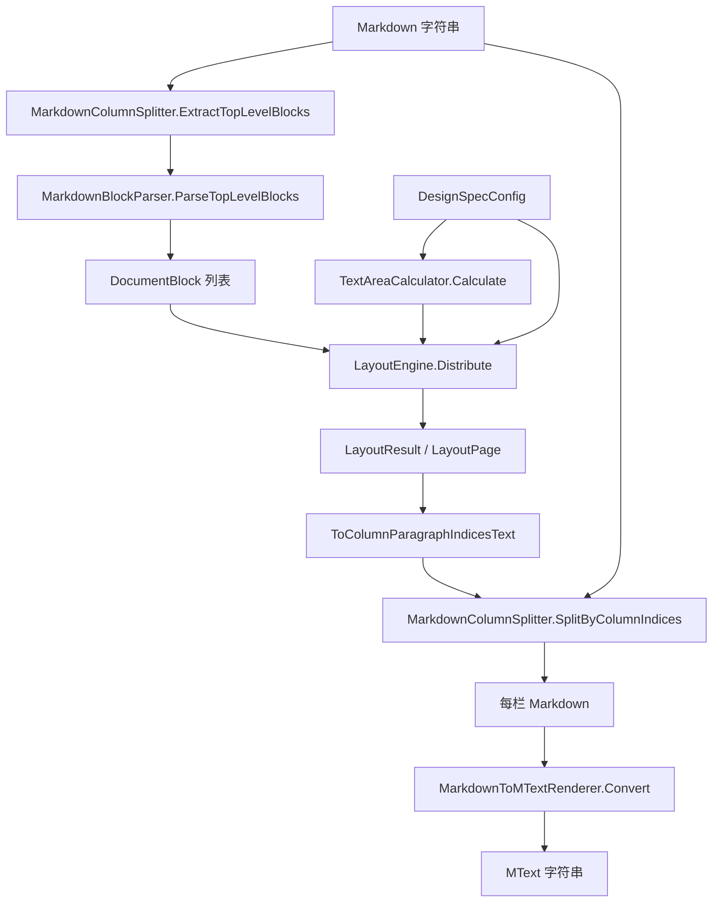

# 项目架构

> 面向 AI 阅读：路径精确到文件、命名与代码一致，供检索与改码定位。
> 产品逻辑与用户视角见 [01-核心逻辑](01-核心逻辑.md)。

## 项目目标

为 HyCAD 设计说明提供与 AutoCAD API 解耦的 Markdown 切块、估高、分栏分页与 MText 字符串生成；宿主是 `HyCADTool`（net48 插件）。**已验证**。

## 技术栈

| 层级 | 技术 | 版本 | 说明 |
|---|---|---|---|
| 目标框架 | netstandard2.0 | csproj | 供 net48 的 `HyCADTool` 引用 |
| 语言 | C# | LangVersion 8.0 | 与主工程一致 |
| Markdown 解析 | Markdig | 0.37.0 | `UseAdvancedExtensions()`，含 GFM 表 |
| 宿主引用 | ProjectReference | — | `src/HyCADTool/HyCADTool.csproj` |

## 模块划分

| 模块 | 职责 | 入口文件（相对仓库根） |
|---|---|---|
| 配置 | 纸张/栏/字号/段距；`Normalize`/`Validate`；页面驱动栏宽 | `src/HyCADTool.TextLayout/DesignSpecConfig.cs` |
| 多级列表 | 最多 7 级编号/项目符号与缩进字数 | `src/HyCADTool.TextLayout/MultilevelListConfig.cs` |
| 模型 | `DocumentBlock`、`LayoutResult`、`LayoutPage`、增量元数据 | `src/HyCADTool.TextLayout/LayoutModels.cs` |
| 切块 | Markdig 顶层 span 切片；失败则按空行回退 | `src/HyCADTool.TextLayout/MarkdownColumnSplitter.cs` |
| 块标注 | 类型/标题级别/显示单位/`IsBreakable` | `src/HyCADTool.TextLayout/MarkdownBlockParser.cs` |
| 宽度口径 | ASCII=1，CJK/全角=2，空白跳过 | `src/HyCADTool.TextLayout/DisplayWidthCalculator.cs` |
| 文本区 | 各栏宽与总宽 | `src/HyCADTool.TextLayout/TextAreaCalculator.cs` |
| 布局 | `Distribute` 全量流式分页；`DistributeIncremental` 全量后再 diff | `src/HyCADTool.TextLayout/LayoutEngine.cs` |
| 表格抽取 | 顶层表 → `MarkdownTableData`；可剥离表块 | `src/HyCADTool.TextLayout/MarkdownTableExtractor.cs` |
| MText 渲染 | Markdown AST → MText 控制码 | `src/HyCADTool.TextLayout/MarkdownToMTextRenderer.cs` |

## 目录映射（必填）

| 目录 / 文件 | 归属模块 | 说明 |
|---|---|---|
| `src/HyCADTool.TextLayout/*.cs` | 本程序集全部公开类型 | 扁平，无子命名空间 |
| `src/HyCADTool.TextLayout/HyCADTool.TextLayout.csproj` | 工程 | 仅 Markdig 包引用 |
| `src/HyCADTool.TextLayout/docs/` | 文档 | 本目录 |
| `src/HyCADTool/HyCADTool.csproj` | 宿主 | `ProjectReference` 本工程 |
| `src/HyCADTool/Features/DesignSpec/Services/DesignSpecService.cs` | 宿主消费 | `MarkdownBlockParser`、`LayoutResult`、`DocumentBlock` |
| `src/HyCADTool/Features/DesignSpec/Services/EditorLoader.cs` | 宿主消费 | `LayoutEngine.Distribute` 作为无 `LayoutResult` 时的回退；类注释写明 hymd 已不走本加载器 |
| `src/HyCADTool/Features/DesignSpec/Domain/Models/DesignSpecConfig.cs` | 平行配置 | 字段更多（MText 粗体/斜体/对齐等）；`MultilevelList` 类型来自本程序集 |
| `src/HyCADTool/Features/DesignSpec/Domain/Models/MarkdownToMTextRenderer.cs` | 平行渲染 | `Insert` / `InsertFromHyMdDump` 实际 `new` 的是这一份 |
| `src/HyCADTool/Features/DesignSpec/Domain/Models/MarkdownColumnSplitter.cs` | 平行切栏 | 与本库同名同类逻辑 |
| `src/HyCADTool/Features/DesignSpec/Domain/Models/MarkdownTableExtractor.cs` | 平行抽表 | `DesignSpecService` 用这一份 |
| `src/HyCADTool/Features/DesignSpec/Domain/Models/DisplayWidthCalculator.cs` | 平行宽度 | 与本库算法相同 |
| `src/HyCADTool/Features/DesignSpec/Domain/Models/TextAreaCalculator.cs` | 平行文本区 | 入参是 Domain `DesignSpecConfig` |
| `src/HyCADTool/Features/DesignSpec/Services/CadLayoutDump.cs` | HyMd 贴图 DTO | 现行贴图几何；不经过 `LayoutEngine` |

## 数据流 / 交互

现行 `hymd` 贴图（`DesignSpecService.InsertFromHyMdDump`）：HyMd → `CadLayoutDump` 每块 `XMm/YMm/WidthMm` → Domain `MarkdownToMTextRenderer.Convert` → CAD `MText`。不调用 `LayoutEngine`。**已验证**。

`EditorLoader.ToLayoutConfig` 把 Domain 配置拷到本库 `DesignSpecConfig`（含 `TextXScale`）。本库默认 `TextXScale=0.7`，Domain 默认 `1.0`；走映射时以 Domain 值为准。**已验证**。

`DistributeIncremental`：仍先 `Distribute` 全量，再与旧 `LayoutResult` 比放置位置。`HyCADTool` 内无调用点。**已验证**。

## 关键架构决策

| 决策 | 选择 | 理由 | 日期 |
|---|---|---|---|
| 与 CAD 解耦 | netstandard2.0 + 只依赖 Markdig | 主工程 net48 可引用，排版可单测（当前无测试工程） | 读 csproj，日期不详 |
| 栏宽口径 | 页面尺寸优先，否则 `CharsPerColumn × 字宽` | 跟图纸边距对齐 | 读 `GetColumnWidth` |
| 分栏单位 | Markdig 顶层 Block span | 避免表/围栏代码被空行切开 | 读 `ExtractTopLevelBlocks` |
| 估高 | 显示单位 / 每行字数，非字形 | 无字体文件、与预览约定同一尺子 | 读 `EstimateBlockHeightMm` |
| 双份类型 | DesignSpec Domain 保留更完整渲染与 CAD 字段 | 现行贴图用 Domain 渲染器；本库渲染器偏简 | 读 `InsertFromHyMdDump` |
| 增量布局 | 全量重算 + metadata | 实现存在但宿主未接 | 读 `DistributeIncremental` + 全库检索 |

---

**证据级别**：路径、引用、贴图不经 `LayoutEngine`、增量无调用点 **已验证**；本库与 CAD 目视一致 **待验证**。
**版本**：v1.0 | **更新**：2026-09-01
