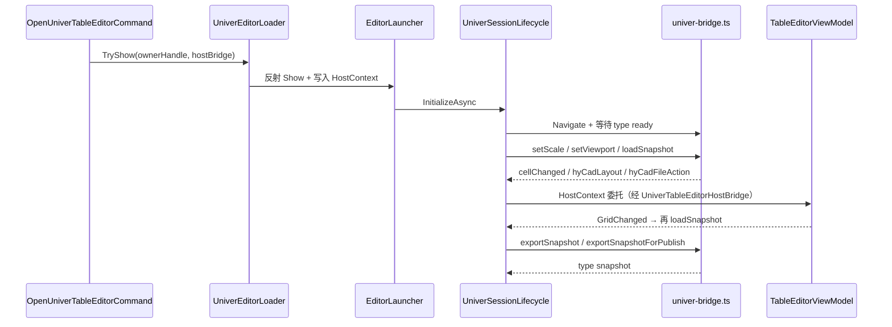

# 项目架构

> 面向 AI 阅读：路径精确到文件、命名与代码一致，供检索与改码定位。
> 产品逻辑与用户视角见 [01-核心逻辑](01-核心逻辑.md)。

## 项目目标

为 HyCADTool（net48 AutoCAD 插件）提供 net8 侧车：WebView2 承载 Univer Sheets，经 JSON 快照与 `UniverEditorHostContext` 委托对接 `TableGrid` / 落图 / 拾取。

## 技术栈

| 层级 | 技术 | 版本 | 说明 |
|---|---|---|---|
| 侧车运行时 | .NET | net8.0-windows | 不能被 net48 主工程直接引用程序集，故反射加载 |
| 主插件 | .NET Framework | net48 | 命令、ViewModel、CAD 渲染 |
| 领域 | HyCAD.Tables | 主工程 ProjectReference | TableGrid / TableOpLog / 纸面 mm |
| 窗口 | WPF + WebView2 | Microsoft.Web.WebView2 1.0.3065.39 | 无边框窗口壳 + 内嵌网页 |
| JSON | Newtonsoft.Json | 13.0.3 | 宿主消息与快照 |
| 前端打包 | Vite | 5.4.11 | `base: './'`，产出 `Web/dist` |
| 表格引擎 | @univerjs/* | 0.25.0 | Sheets + UI + formula + numfmt |
| UI 注入 | React | 18.3.1 | 布局 Ribbon 面板 |

## 模块划分

| 模块 | 职责 | 入口文件（相对仓库根） |
|---|---|---|
| 静态入口 | 单例窗口、委托锁、Owner 句柄 | `src/HyCADTool.UniverEditor/EditorLauncher.cs` |
| 宿主契约 | net48 注入的回调槽 | `src/HyCADTool.UniverEditor/UniverEditorHostContext.cs` |
| 会话 | 解析 dist、虚拟主机、postMessage 分发 | `src/HyCADTool.UniverEditor/Services/UniverSessionLifecycle.cs` |
| WebView2 环境 | 共享 UserData 目录、预热 | `src/HyCADTool.UniverEditor/Services/WebView2EnvironmentProvider.cs` |
| 窗口 | XAML 壳、Ready 后回灌快照、落图前让出 Topmost | `src/HyCADTool.UniverEditor/Views/UniverEditorWindow.xaml` |
| 前端入口 | 注册 Univer 插件栈与 HyCAD 注入 | `src/HyCADTool.UniverEditor/Web/src/main.ts` |
| 快照桥 | load/export/cellChanged、mm 尺寸 | `src/HyCADTool.UniverEditor/Web/src/univer-bridge.ts` |
| 反射加载器 | 找 DLL、绑 HostContext | `src/HyCADTool/Features/Tables/Services/UniverEditorLoader.cs` |
| VM 桥 | 快照映射、超时导出、布局 op → ViewModel | `src/HyCADTool/Features/Tables/Services/UniverTableEditorHostBridge.cs` |
| 命令 | AutoCAD N38 | `src/HyCADTool/Features/Tables/Commands/OpenUniverTableEditorCommand.cs` |

主工程对侧车的 ProjectReference 设 `ReferenceOutputAssembly=false`，只为把产物编进 `bin\$(Configuration)\net8\`。

## 目录映射（必填）

| 目录 / 文件 | 归属模块 | 说明 |
|---|---|---|
| `src/HyCADTool.UniverEditor/HyCADTool.UniverEditor.csproj` | 构建 | `OutputPath` → `src/HyCADTool/bin/$(Configuration)/net8/`；`BuildWebAssets` 在编译前 `npm run build` |
| `src/HyCADTool.UniverEditor/UniverWebSnapshotMessage.cs` | 会话 | exportSnapshot 回传 DTO |
| `src/HyCADTool.UniverEditor/Views/Controls/RulerControl.cs` | 窗口（未挂接） | WPF 毫米标尺；当前窗口 XAML 未引用，运行时标尺在 Web overlay |
| `src/HyCADTool.UniverEditor/Web/vite.config.ts` | 前端构建 | 开发服 `127.0.0.1:5174`，`strictPort` |
| `src/HyCADTool.UniverEditor/Web/src/file-tab-inject.ts` | 前端壳 | 「文件▾」→ `hyCadFileAction` |
| `src/HyCADTool.UniverEditor/Web/src/layout-tab-inject.ts` | 布局 | 「布局」Tab + 第二行 Ribbon |
| `src/HyCADTool.UniverEditor/Web/src/layout-ribbon-panel.tsx` | 布局 | 结构模式、纸张、行列、合并、Scale |
| `src/HyCADTool.UniverEditor/Web/src/layout-ribbon-model.ts` | 布局 | Ribbon 状态；纸张预设 A4/A3/A2 |
| `src/HyCADTool.UniverEditor/Web/src/page-viewport.ts` | 布局几何 | 唯一编排者：调用 `applyGridFitStep` 后设 zoom |
| `src/HyCADTool.UniverEditor/Web/src/layout-grid-fit.ts` | 布局几何 | `applyGridFitStep` 纯函数；`installLayoutGridFit` 只返回 teardown |
| `src/HyCADTool.UniverEditor/Web/src/mm-display.ts` | 单位 | `DISPLAY_PX_PER_MM = 96/25.4`，与 `TableMmDefaults` 同值 |
| `src/HyCADTool.UniverEditor/Web/src/ruler-overlay.ts` | 标尺 | DOM 标尺 |
| `src/HyCADTool.UniverEditor/Web/src/grid-ruler-overlay.ts` | 标尺 | 网格标尺 |
| `src/HyCADTool.UniverEditor/Web/src/dev-host.ts` | 浏览器 mock | 无 WebView2 时模拟宿主 |
| `src/HyCADTool.UniverEditor/Web/src/dev-panel.ts` | 浏览器 mock | 左下角验收面板 |
| `src/HyCADTool.UniverEditor/Web/public/fixtures/personnel-snapshot.json` | 样表 | 人员样表 fixture |
| `src/HyCADTool/Features/Tables/Presentation/UniverGridSnapshot.cs` | 主工程映射 | `UniverGridSnapshotMapper` |
| `src/HyCAD.Tables/` | Domain | TableGrid 真相源；本侧车不实现落图几何 |

## 数据流 / 交互

虚拟主机：`https://univer.local/index.html` ← `SetVirtualHostNameToFolderMapping("univer.local", distPath)`。

布局结构操作：网页 `hyCadLayout` → `HandleHyCadLayout` → `OnLayoutOp` → ViewModel 命令 → OpLog → `NotifyGridChanged` → 回灌快照。`setScale` 只改 VM.Scale，不改 grid。

## 关键架构决策

| 决策 | 选择 | 理由 | 日期 |
|---|---|---|---|
| 跨 TFM | net8 DLL + 反射，不引用程序集 | net48 插件进程不能直接引用 net8 | 2026-06 |
| 真相源 | TableGrid + TableOpLog；Univer 仅视图 | 避免 workbook 与 DWG 双真相 | 2026-06 |
| 尺寸 | 口径 B：纸面 mm；落图 ×Scale | 与 CAD 模型空间一致 | 2026-06-27 |
| UI 改动落点 | TypeScript + Vite HMR，不把 Ribbon 转写 WPF | 热更新快 | 2026-06 |
| 布局几何 | `page-viewport.ts` 编排，`applyGridFitStep` 不自订 zoom | 两边各自算会导致网格溢出纸面 | 见 LAYOUT_FIX_PLAN，代码已落地 |
| Excel 互通 | 主工程 NPOI，不经 Univer Pro | 控制依赖与格式 | 2026-06 |

日期栏中 2026-06 / 2026-06-27 来自主题文档记录，**推断**；「page-viewport 为唯一编排者」对照 `layout-grid-fit.ts` / `page-viewport.ts`，**已验证**。

---

**版本**：v1.0 | **更新**：2026-09-01
